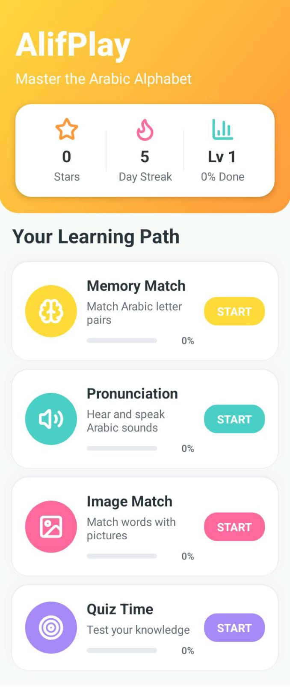
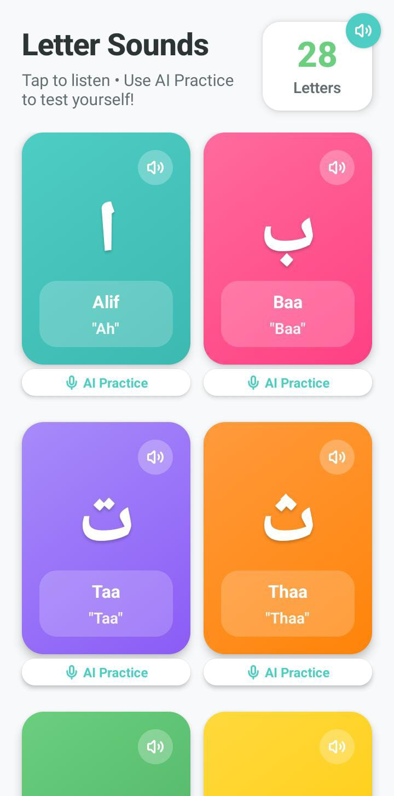
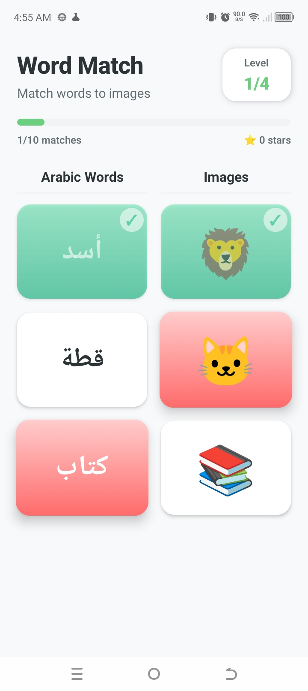
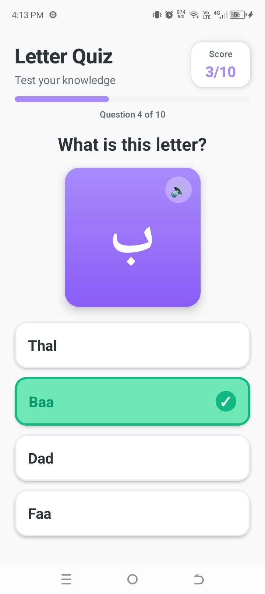
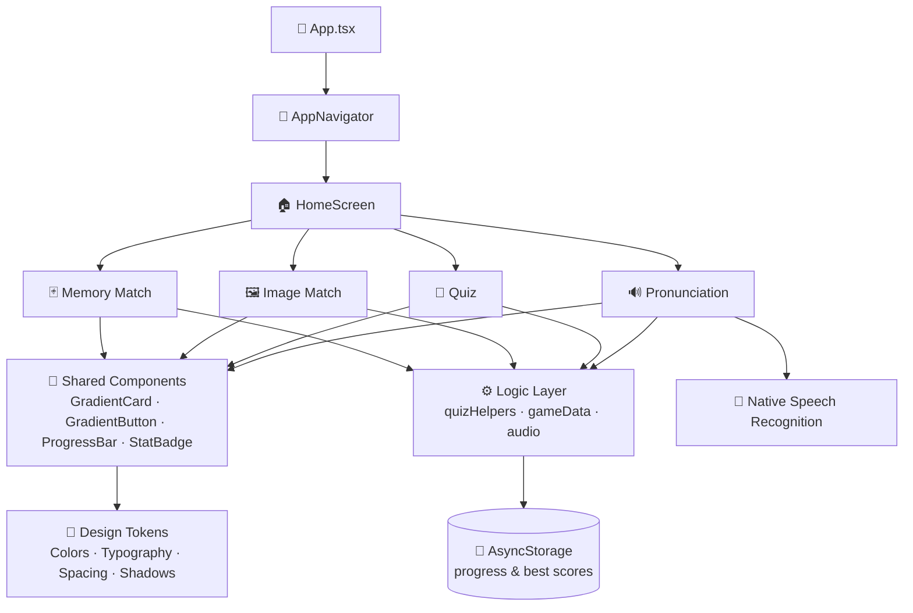

<div align="center">

 
 
# 🌙 AlifPlay
 
### Learn Arabic by playing. Speak it, hear it, match it, win it.
 
**An offline-first, voice-powered Arabic alphabet game for kids, built with React Native + Expo.**
 
[](https://expo.dev)
[](https://reactnative.dev)
[](https://www.typescriptlang.org)
[](#-quick-start)
 
[](https://github.com/salmanazamdev/alifplay-arabic-learning-game/stargazers)
[](https://github.com/salmanazamdev/alifplay-arabic-learning-game/network/members)
[](https://github.com/salmanazamdev/alifplay-arabic-learning-game/issues)
[](https://github.com/salmanazamdev/alifplay-arabic-learning-game/commits)
[](#-contributing)
 
[**Quick Start**](#-quick-start) ·
[**Features**](#-features) ·
[**Pronunciation AI**](#-pronunciation-ai) ·
[**Architecture**](#-architecture) ·
[**Roadmap**](#-roadmap) ·
[**Contributing**](#-contributing)
 
</div>
---
 
## 🤔 Why AlifPlay?
 
Arabic is the language of the Qur'an and of 400+ million people, yet millions of children, especially in non-Arabic-speaking Muslim families, meet it through dry worksheets and static flashcards. They lose interest before they ever reach the second letter.
 
**AlifPlay flips that.** Every letter is a game. Every sound is a reward. Every mistake gets an encouraging nudge instead of a red cross.
 
| 😴 The old way | 🚀 The AlifPlay way |
| --- | --- |
| Text-heavy lessons | Colorful, gamified mini-games |
| Passive listening | Speak into the app and get real pronunciation feedback |
| Needs internet | **Offline-first**, works anywhere |
| One-size-fits-all | Star-based scoring and encouragement tuned for kids |
| Heavy downloads | Aggressively optimized assets |
 
---
 
## ✨ Features
 
### 🎮 Four games, one alphabet
 
| Game | What the child does | Why it works |
| --- | --- | --- |
| 🔊 **Pronunciation Practice** | Taps a letter, hears it, then **says it back** | Multi-sensory: see, hear, speak |
| 🧠 **Quiz Game** | 10 randomized questions with *real* wrong answers drawn from other letters | Builds true discrimination, not guessing |
| 🖼️ **Image Match** | Matches Arabic words to pictures | Vocabulary through visual association |
| 🃏 **Memory Match** | Flips cards to find pairs of Arabic letters | Trains letter recognition and recall |
 
### 🎤 Pronunciation AI
 
Real on-device speech recognition scores how a child actually pronounces each letter. No faked demo scores. If the speech engine isn't available, the app tells you why instead of pretending. [Details below ↓](#-pronunciation-ai)
 
### 🏆 Motivation built in
 
- ⭐ 1 to 3 star scoring on quizzes
- 💬 Encouraging messages based on performance
- 📈 Best-score persistence across sessions (Memory Match)
- 🎉 Success celebrations and haptic feedback on every flip, match and win
### 🎨 A real design system
 
- **60+ design tokens** for colors, typography, spacing, shadows, radii and animation
- 6 gradient card variants for a clear visual hierarchy
- **Cairo** and **Amiri** fonts for crisp Arabic typography
- Responsive layout that adapts to different screen sizes
### ♿ Accessibility first
 
- Screen-reader labels, hints and semantic roles on interactive elements
- High-contrast color choices
- Progress indicators with proper accessibility values
### ⚡ Performance obsessed
 
- Optimized `FlatList` rendering (`removeClippedSubviews`, batched rendering, tuned window size)
- `React.memo` and `useCallback` for stable, efficient re-renders
- **Asset footprint cut from 90 MB → 5.4 MB**
- Smooth **60 FPS** animations
- Audio processing in **~35 ms**
---
 
## 📸 Screenshots
 
<div align="center">
<table>
  <tr>
    <td align="center"><br/><b>Home</b></td>
    <td align="center"><br/><b>Pronunciation</b></td>
  </tr>
  <tr>
    <td align="center"><br/><b>Image Match</b></td>
    <td align="center"><br/><b>Quiz</b></td>
  </tr>
</table>
</div>

 
---
 
## 🚀 Quick Start
 
### Prerequisites
 
- Node.js 18+
- npm
- [Expo CLI](https://docs.expo.dev/get-started/installation/) (via `npx`)
- Android Studio / a physical Android device (recommended for Pronunciation AI)
### Run it
 
```bash
# 1. Clone
git clone https://github.com/salmanazamdev/alifplay-arabic-learning-game.git
cd alifplay-arabic-learning-game
 
# 2. Install
npm install
 
# 3. Launch
npx expo start
```
 
Press **`a`** for Android, **`i`** for iOS, or scan the QR code with Expo Go.
 
> ⚠️ **Heads up:** Pronunciation AI uses a native speech module and does **not** run in Expo Go. Use a custom dev build ([instructions below](#-pronunciation-ai)). Every other game works in Expo Go.
 
### All commands
 
| Command | What it does |
| --- | --- |
| `npm start` | Start the Expo dev server |
| `npm run android` | Run on Android |
| `npm run ios` | Run on iOS |
| `npm run web` | Run on web (limited support) |
| `npx expo run:android --clear` | Clean native Android dev build |
| `npx tsc --noEmit` | Type-check the whole project |
| `eas build --platform android --profile development` | EAS development build |
| `eas build --platform android --profile production` | EAS production build |
 
---
 
## 🎤 Pronunciation AI
 
AlifPlay scores a child's spoken letter using **native speech recognition** (`@react-native-voice/voice`) and a phonetic-matching layer that accepts **168+ phonetic variations**, so a child's genuine attempt isn't rejected because the recognizer wrote the sound a different way.
 
**No simulated scoring.** If the engine isn't available, you get an actionable error, not fake results.
 
### Requirements
 
- ✅ Custom Android dev build (`expo run:android` or an EAS dev build)
- ✅ A real Android device (best results)
- ✅ Microphone permission granted
- ❌ Not supported: Expo Go
### Verify your setup
 
```bash
# 1) Confirm your device is connected
adb devices
 
# 2) Build and run the native Android app
npx expo run:android --clear
 
# 3) Open Pronunciation → tap "AI Practice"
```
 
### Troubleshooting
 
| Message | Fix |
| --- | --- |
| `Microphone permission is required` | Enable the microphone for AlifPlay in Android app settings |
| `native module is unavailable` | Rebuild as a custom dev client with `npx expo run:android` |
| `speech engine unavailable` | Test on a physical Android phone with Google speech services enabled |
 
---
 
## 🏗️ Architecture
 
A clean, layered, offline-first design that scales.
 

 
### 📁 Project structure
 
```
AlifPlay/
├── src/
│   ├── components/          # Reusable UI (GradientButton, GradientCard, ProgressBar, StatBadge, ErrorBoundary)
│   ├── constants/           # Design tokens (Colors, Typography, Spacing, Shadows, BorderRadius, Animation)
│   ├── screens/             # Home, Pronunciation, Quiz, ImageMatch, MemoryGame, Splash
│   ├── navigation/          # React Navigation setup (AppNavigator)
│   ├── utils/
│   │   ├── gameData.ts      # Arabic letters data
│   │   ├── quizHelpers.ts   # Quiz generation logic
│   │   ├── audio.ts         # Audio playback
│   │   └── storage.ts       # AsyncStorage wrapper
│   └── assets/              # Images, fonts, audio
├── App.tsx                  # Entry point
├── app.json                 # Expo configuration
└── package.json
```
 
### 🛠️ Tech stack
 
| Layer | Tech |
| --- | --- |
| Framework | React Native + **Expo SDK ~54** |
| Language | **TypeScript** (~5,000 lines) |
| Navigation | React Navigation |
| Audio | `expo-av` |
| Speech recognition | `@react-native-voice/voice` |
| Haptics | `expo-haptics` |
| Storage | `@react-native-async-storage/async-storage` |
| Typography | Expo Google Fonts (**Cairo**), **Amiri** |
| Builds | EAS Build |
 
---
 
## 🎨 Design System
 
Everything pulls from shared tokens, so changing the whole look of the app takes minutes, not days.
 
```ts
import { Colors, FontSize, FontWeight, Spacing, Shadows, BorderRadius } from './src/constants';
 
const styles = StyleSheet.create({
  card: {
    backgroundColor: Colors.white,
    padding: Spacing.lg,
    borderRadius: BorderRadius.lg,
    ...Shadows.medium,
  },
  title: {
    fontSize: FontSize.h2,
    fontWeight: FontWeight.bold,
    color: Colors.text,
  },
});
```
 
<details>
<summary><b>🧩 Component cookbook</b></summary>
```tsx
// GradientButton
<GradientButton text="Start Game" onPress={handleStart} variant="success" />
 
// ProgressBar
<ProgressBar progress={75} color={Colors.primaryBlue} />
 
// StatBadge
<StatBadge value={28} label="Letters" />
 
// GradientCard
<GradientCard
  gradientColors={[Colors.primaryBlue, Colors.primaryBlueDark]}
  onPress={handlePress}
  isSelected={isSelected}
>
  <Text>Card Content</Text>
</GradientCard>
```
 
</details>
---
 
## 🎮 Game Deep-Dive
 
<details>
<summary><b>🔊 Pronunciation Practice</b></summary>
- All **28 Arabic letters** with audio playback
- Gradient cards in 6 color variations
- Haptic feedback and visual playback state
- AI Practice mode for speaking and scoring (custom dev build required)
</details>
<details>
<summary><b>🧠 Quiz Game</b></summary>
- 10 randomized questions per round
- Wrong answers come from *real* other letters, not filler
- Live progress with percentage
- 1 to 3 star scoring and performance-based encouragement
</details>
<details>
<summary><b>🖼️ Image Match</b></summary>
- 10 Arabic words paired with emoji imagery
- Shuffle logic for replay variety
- Match-detection animations, reset, and success celebrations
</details>
<details>
<summary><b>🃏 Memory Match</b></summary>
- 12-card board with 6 Arabic letter pairs
- Reshuffles every game
- Move counter and completion tracking
- Haptics on flips and matches
- Best score saved across sessions
</details>
---
 
## 🔐 Security & Public Repo Notes
 
- No production API secrets live in source code.
- Local machine files (Android SDK paths, IDE metadata) stay untracked.
- Android release signing credentials are provided **locally only** and must never be committed.
<details>
<summary><b>🔑 Android release signing (local setup)</b></summary>
Set these Gradle properties in `~/.gradle/gradle.properties` or a local, untracked `android/gradle.properties`:
 
```properties
ALIFPLAY_UPLOAD_STORE_FILE=/absolute/path/to/your-release-key.keystore
ALIFPLAY_UPLOAD_STORE_PASSWORD=your_store_password
ALIFPLAY_UPLOAD_KEY_ALIAS=your_key_alias
ALIFPLAY_UPLOAD_KEY_PASSWORD=your_key_password
```
 
If these are missing, release builds fall back to debug signing for **local development only**.
 
</details>
---
 
## 🧭 Roadmap
 
- [x] Pronunciation Practice with audio
- [x] Quiz Game with star scoring
- [x] Image Match
- [x] Memory Match with best-score persistence
- [x] On-device Pronunciation AI
- [x] Design system, accessibility pass and error boundaries
- [ ] 🧩 Word-building and listening exercises
- [ ] 🏅 Achievement system with badges
- [ ] 👨‍👩‍👧 Parent dashboard with progress tracking
- [ ] 🎚️ Multiple difficulty levels
- [ ] ☁️ Optional cloud sync (Supabase)
- [ ] 🏆 Leaderboards and sharing
- [ ] 🌍 More languages (Urdu UI and beyond)
Have an idea? [Open an issue](https://github.com/salmanazamdev/alifplay-arabic-learning-game/issues/new), I'd love to hear it.
 
---
 
## 🤝 Contributing
 
Contributions make open source great, and kids' education better. Here's how to jump in:
 
1. 🍴 **Fork** the repo
2. 🌿 Create a branch: `git checkout -b feature/amazing-idea`
3. ✅ Make sure it type-checks: `npx tsc --noEmit`
4. 💾 Commit: `git commit -m "feat: add amazing idea"`
5. 🚀 Push and open a **Pull Request**
**Great first contributions:**
- 🎙️ Better audio recordings for letters
- 🌐 Translations and localization
- 🎮 New mini-game ideas
- ♿ Accessibility improvements
- 🐛 Bug reports with reproduction steps
---
 
## 🧾 Asset Attribution
 
AlifPlay uses or can download third-party assets. Please verify license terms before redistributing.
 
- **Fonts:** [Amiri](https://github.com/aliftype/amiri) and [Cairo](https://github.com/Gue3bara/Cairo)
- **Images:** Emoji assets from [Twemoji](https://github.com/twitter/twemoji)
- **Audio generation:** The Arabic TTS download script uses Google Translate TTS endpoints for development convenience. You are responsible for complying with the applicable terms of service.
<!-- ## 📄 License
[Add your license here]
-->
 
---
 
## 🙏 Acknowledgments
 
- The **Expo** team and the **React Native** community
- **Google TTS** for development-time audio generation
- Every parent and teacher helping a child fall in love with Arabic 🤍
---
 
<div align="center">
### Built with ❤️ by [Salman Azam](https://github.com/salmanazamdev)
 
**If AlifPlay helps you, or you just love the idea, drop a ⭐. It genuinely helps.**
 
[](https://github.com/salmanazamdev/alifplay-arabic-learning-game)
 
*أَلِف: the first letter. The first step. Let's make it fun.* 🌙
 
</div>
 